# architecture-skills

[Agent Skills](https://agentskills.io) for software architecture. It currently ships one skill:

- **`c4-diagrams`**: analyzes a local repository and produces [C4 model](https://c4model.com/) diagrams, key-flow sequence diagrams, deployment, API and configuration views, and recommendations based on what the analysis found. It reads .NET, Java/Kotlin, Go, Node.js/TypeScript and Python code. It works in Claude Code, Codex, Cursor, Gemini CLI, OpenCode, GitHub Copilot CLI, pi and any other agent that reads `SKILL.md`.

| C4 level | Shows | Where it comes from |
|---|---|---|
| 1 · System context | the system, its users, the external systems it talks to | the agent, from the code and docs, in an editable `c4-model.json` |
| 2 · Containers | what runs on its own (web API, web app, worker, CLI) and its data stores | detected in project files, dependencies, EF Core/DB clients, docker-compose |
| 3 · Components | each container's modules, then the packages/namespaces inside them (Java/Kotlin packages, C# folders, Go packages) and their imports | the code, without tests; the agent describes the important ones |
| 4 · Code | the classes and interfaces of the key components: inheritance, dependencies, public methods | the agent picks the components; the script extracts the types |
| Key flows | 1–3 important requests traced step by step as sequence diagrams | the agent, from the code, in `c4-model.json` |

The report also has sections built straight from the code:

| Section | Contents |
|---|---|
| Deployment | docker-compose services and their dependencies (as a diagram), Dockerfiles (stages, runtime image, ports, entry point), Kubernetes workloads, CI and hosting files |
| API endpoints | HTTP routes from Spring, JAX-RS, ASP.NET (attribute-routed and conventional MVC controllers, minimal APIs), Express/Fastify/Koa/NestJS, FastAPI/Flask/Django, Go net/http, gin, echo and chi |
| Configuration | environment variables the code reads or compose sets, with defaults, and the config files found |
| Technology inventory | runtime, frameworks and key libraries with versions, per container |

**See it:** [`examples/bookshop/ArchitectureReport.md`](examples/bookshop/ArchitectureReport.md) is a complete report for a small synthetic shop (web app, API, database, a search index another team runs, a payment provider).

Each level is its own diagram, so no single picture has to show everything. Diagrams with more than 20 components are split by module or folder, and in dense graphs shortcut edges are hidden.

The full dependency graph stays in an appendix:

| Stack | What becomes a node | What becomes an edge |
|---|---|---|
| .NET | `.csproj` / `.fsproj` / `.vbproj` | `<ProjectReference>` |
| Node.js monorepo | each workspace package | dependency on another workspace package |
| Node.js / TypeScript single package | folders | imports (relative, tsconfig `baseUrl` / `paths`) |
| Python | distributions, or subpackages/modules of a single package | requirements / `import` statements |
| Maven / Gradle | modules / included projects | inter-module dependencies |
| Go | modules (several `go.mod`), or package folders of one module (`cmd/x`, `internal/x`, …) | `require` lines / imports |

The analysis also checks for dependency cycles, projects outside the solution or workspace, unresolved references, and modules that no test imports.

## Install

### Any agent

[`npx skills`](https://github.com/vercel-labs/skills) installs the skills into every Agent-Skills-compatible agent it finds (Codex, Cursor, OpenCode, Gemini CLI, GitHub Copilot, Windsurf, Cline, Claude Code and others):

```bash
npx skills add ythalorossy/architecture-skills          # this project
npx skills add ythalorossy/architecture-skills -g       # your user account
npx skills add ythalorossy/architecture-skills -a codex -a cursor   # chosen agents only
```

It symlinks one copy into each agent's skills folder (`.agents/skills/`, `~/.codex/skills/`, `~/.cursor/skills/`, `~/.config/opencode/skills/`, `~/.gemini/skills/`, `~/.copilot/skills/`, …). Add `--copy` for independent copies. Update later with `npx skills update`.

### Through the agent's own installer

| Agent | Install |
|---|---|
| Claude Code | `/plugin marketplace add ythalorossy/architecture-skills` then `/plugin install architecture-skills@ythalorossy`. Update: `/plugin marketplace update ythalorossy` |
| Codex | `codex plugin marketplace add ythalorossy/architecture-skills`, then `/plugins` → *architecture-skills* → Install |
| Cursor | Clone the repo into `~/.cursor/plugins/local/architecture-skills` and reload the window, or import the repo as a team marketplace |
| Gemini CLI | `gemini extensions install https://github.com/ythalorossy/architecture-skills`. Update: `gemini extensions update architecture-skills` |
| GitHub Copilot CLI | `copilot plugin marketplace add ythalorossy/architecture-skills` then `copilot plugin install architecture-skills@ythalorossy` |
| OpenCode | In `opencode.json`: `"plugin": ["architecture-skills@git+https://github.com/ythalorossy/architecture-skills.git"]` (`"plugins"` on OpenCode 2.0.4+), then restart |
| pi | `pi install git:github.com/ythalorossy/architecture-skills` |

### Manual

Copy `skills/c4-diagrams/` (or any skill folder under `skills/`) into your agent's skills folder (for example `~/.claude/skills/`, `~/.codex/skills/`, `~/.agents/skills/`).

## Upgrading from 2.x

Until 2.2.0 the repository, plugin and skill were all called `architecture-diagram-generator`. From 3.0.0 the repository and plugin are `architecture-skills` and the skill is `c4-diagrams`, so Claude Code shows `/architecture-skills:c4-diagrams`. The old repository URL redirects to the new one.

```bash
# Claude Code
claude plugin uninstall architecture-diagram-generator@ythalorossy
claude plugin marketplace update ythalorossy
claude plugin install architecture-skills@ythalorossy

# npx skills
npx skills remove architecture-diagram-generator -g
npx skills add ythalorossy/architecture-skills -g
```

Existing `architecture-docs/` output folders and `c4-model.json` files keep working.

## Requirements

| Tool | Required? | Version | Used for |
|---|---|---|---|
| An agent that reads [Agent Skills](https://agentskills.io) (Claude Code, Codex, Cursor, Gemini CLI, OpenCode, Copilot CLI, pi, …) | Yes | any recent | runs the skill |
| Python | Yes | **3.11+ (checked at startup)** | the analyzer (standard library only, no `pip install`) |
| Node.js | Optional | **22.13+** | rendering the diagrams to SVG with [`@mermaid-js/mermaid-cli`](https://github.com/mermaid-js/mermaid-cli) |

**You don't need the toolchain of the repository you analyze.** The analyzer only reads files (`.csproj`, `package.json`, `pyproject.toml`, `pom.xml`, `settings.gradle`, source imports). You can analyze a .NET or Java repository without the .NET SDK, a JDK, Maven or Gradle installed, and you don't need to run `npm install` first.

### Python

Check your version:

```bash
python3 --version
```

- **3.11 or newer**: required (checked at startup).
- **Older than 3.11**: not supported. The CLI exits with a clear message and an install hint naming `uv python install 3.12` and `brew install python` / python.org.

If your system Python is older, install a newer one with your package manager, [python.org](https://www.python.org/downloads/), or `uv python install 3.12`.

> **Windows:** the skill calls `python3`. If only `python` or `py` is on your PATH, install Python from python.org or the Microsoft Store, which provides `python3`, or ask the agent to use `py -3`.

### Node.js and mermaid-cli (optional, for the SVG)

The report embeds the diagrams as SVGs so they show in any Markdown viewer, including VS Code's built-in preview, which doesn't render Mermaid. The analyzer uses `mmdc` if it's on your PATH, and otherwise falls back to `npx -y @mermaid-js/mermaid-cli@12.0.0` (pinned version).

Install mermaid-cli once, globally:

```bash
node --version          # must be 22.13 or newer
npm install -g @mermaid-js/mermaid-cli
mmdc --version
```

Installing it ahead of time is recommended. With the `npx` fallback, the first run downloads mermaid-cli and a headless Chrome (a few hundred MB). Each diagram tries npm's cache first and goes online only if the package isn't cached (`ENOTCACHED`). The timeouts are 180 s per diagram and 600 s for that first download; `C4_SVG_TIMEOUT_PER_DIAGRAM` and `C4_SVG_TIMEOUT_INSTALL` change them.

Each SVG render returns a status: `ok` (SVG written), `syntax-error` (bug in the diagram — fix the model), `timeout` (diagram too complex), `tool-error` (other failure), `missing-tool` (neither mmdc nor npx found), or `skipped` (rendering turned off, or the renderer itself failed to start or timed out on the first diagram). A diagram that fails to render (`syntax-error`, `timeout`, `tool-error`) makes the run `degraded`: it exits 0, sets `status: degraded` in `summary.json` and lists the failure in `warnings`. With `--strict` a degraded run exits 2. A degraded run also comes from files that couldn't be read or parsed, and from an invalid `c4-model.json`.

Use `--no-svg` or set `C4_SVG=0` in the environment to skip all SVG rendering (useful in CI or when Node.js is absent). Without Node.js the analysis still works and the run is still `ok`; the report then contains the Mermaid source instead of images, and the script prints a note.

> **Linux / WSL:** headless Chrome needs some system libraries. If `mmdc` fails with an error such as `error while loading shared libraries: libnss3.so`, install the packages listed in [Puppeteer's troubleshooting guide](https://pptr.dev/troubleshooting#chrome-doesnt-launch-on-linux) for your distribution.

## Usage

Ask your agent, for example:

- *"Generate C4 diagrams for ~/src/my-repo"*
- *"Generate an architecture diagram for ~/src/my-repo"*
- *"Review the architecture of this repository"*
- *"How do the projects in this solution depend on each other?"*

The skill triggers on requests like these.

You can also run the analyzer directly:

```bash
python3 skills/c4-diagrams/scripts/analyze_repository.py <repo_path> [--output <output_dir>]
```

By default the files are written to `./architecture-docs/<repo name>/` in the current directory, so you can keep, commit or delete them.

Output files:

- `ArchitectureReport.md`
- `c4-facts.json`, `c4-container.*`, `c4-component-<container>.*` (modules), `c4-structure-<container>.*` (packages/namespaces), `c4-deployment.*`, and with a model `c4-context.*`, `c4-flow-<flow>.*` and `c4-code-<container>-<component>.*` (Level 4 class diagrams)
- `dependency-graph.mmd` / `.svg` / `.json`, `repository-scan.json`, `summary.json`

Run on its own, the analyzer draws the Container and Component levels from code facts only. Through the skill, the agent also writes `c4-model.json` (people, external systems, component descriptions and key flows, each backed by evidence or marked as an assumption) and draws the System Context level, the flow diagrams and the Level 4 class diagrams of the key components. You can edit `c4-model.json` and redraw every diagram:

```bash
python3 skills/c4-diagrams/scripts/render_c4.py ./architecture-docs/<repo name>
```

The model format is described in [`assets/c4-model-reference.md`](skills/c4-diagrams/assets/c4-model-reference.md).

This is the Container level of the [example](examples/bookshop/ArchitectureReport.md):



## Command reference

### `analyze_repository.py`

```bash
python3 skills/c4-diagrams/scripts/analyze_repository.py <repository> [options]
```

Scans the repository and writes the facts, the facts-only diagrams and the report. An existing `c4-model.json` in the output folder is kept and used.

| Option | Effect |
|---|---|
| `--output <folder>` | Where to write (default `./architecture-docs/<repository name>/` in the current directory). Refused inside the skill folder |
| `--no-svg` | Don't render SVGs; the report shows the Mermaid source |
| `--strict` | Exit 2 when the run is degraded |
| `--timestamp` | Add a "Generated On" time to the report (off by default so re-runs are byte-identical) |
| `--debug` | Show the full traceback of an unexpected error |

### `render_c4.py`

```bash
python3 skills/c4-diagrams/scripts/render_c4.py <output folder> [options]
```

Checks `c4-model.json` against `c4-facts.json` and redraws every C4 diagram and the report's C4 section.

| Option | Effect |
|---|---|
| `--no-svg` | Don't render SVGs |
| `--facts-only` | Ignore `c4-model.json` and draw from the facts alone |
| `--repo <path>` | Where the repository is, when the output folder was moved away from it (needed for Level 4 and evidence checks) |
| `--strict` | Exit 2 when the model drifts from the code |
| `--debug` | Show the full traceback of an unexpected error |

### Environment

| Variable | Effect |
|---|---|
| `C4_SVG=0` | Same as `--no-svg`, for both scripts |
| `C4_SVG_TIMEOUT_PER_DIAGRAM` | Seconds per diagram before the renderer is stopped (default 180) |
| `C4_SVG_TIMEOUT_INSTALL` | Seconds for the first `npx` run, which downloads mermaid-cli and Chrome (default 600) |

### Exit codes and status

| | `analyze_repository.py` | `render_c4.py` |
|---|---|---|
| 0 | done (`summary.json` `status` is `ok` or `degraded`) | the model is `ok`, or `drift` |
| 1 | could not run: bad path, Python older than 3.11, unexpected error | the model is `invalid` (facts-only diagrams were drawn), or could not run |
| 2 | degraded, with `--strict` | drift, with `--strict` |

`summary.json` `status` is `degraded` when a file couldn't be read or parsed, a diagram failed to render, or `c4-model.json` is invalid; each cause is in `warnings`. A missing Node.js is not degraded. `c4.model_status` is `ok`, `drift` (facts the model doesn't cover yet) or `invalid`.

## Troubleshooting

| You see | What to do |
|---|---|
| `python3: command not found` (often on Windows) | Use `python` or `py -3`, or install Python 3.11+ |
| `ERROR: Python 3.11+ is required (found 3.x)` | Install a newer Python (`uv python install 3.12`, python.org, or your package manager) |
| `NOTE: SVGs not rendered: neither mmdc nor npx is on PATH` | Install Node.js 22.13+ (and ideally `npm install -g @mermaid-js/mermaid-cli`). The analysis itself is complete |
| The first run hangs or ends with `timeout` on every diagram | The first `npx` run downloads mermaid-cli and Chrome. Install mermaid-cli globally, or raise `C4_SVG_TIMEOUT_INSTALL` |
| `tool-error` with `error while loading shared libraries: libnss3.so` (Linux, WSL) | Headless Chrome needs system libraries; see [Puppeteer's troubleshooting guide](https://pptr.dev/troubleshooting#chrome-doesnt-launch-on-linux) |
| `WARNING: c4-container: syntax-error — …` | A label in `c4-model.json` breaks Mermaid; fix that text and re-run `render_c4.py`. Without a model, please open an issue with the `.mmd` file |
| `DRIFT: … was found in the code but is not in the model` | The code changed. Add the fact to `c4-model.json`, or list it in `excluded` with a reason |
| `c4-model.json does not match c4-facts.json:` and exit 1 | The model is invalid; the listed errors name the JSON path and often suggest the right id (`did you mean …?`) |
| `WARNING: no container detected` | Nothing with an entry point, a known framework or a compose service was found. Describe the runnable parts in `c4-model.json` yourself |
| `WARNING: No supported projects found` | The stack isn't one the analyzer reads; see Limitations |
| `repository not found at …; re-run analyze_repository.py or pass --repo <path>` | The output folder moved. Pass `--repo <path to the repository>` to `render_c4.py` |
| `the output folder is inside the skill folder` | Run from your repository's folder, or pass `--output` |

## Limitations

- **Detection is pattern-based.** Containers, stores and external systems are found from manifests, framework imports, client libraries, URLs and docker-compose. Something reached only through an in-house wrapper, reflection, or configuration the analyzer doesn't read can be missed. The skill asks the agent to add what it finds in the code, with evidence.
- **Languages:** .NET (C#, F#, VB), Java/Kotlin (Maven, Gradle), Go, Node.js/TypeScript and Python. Other languages are not analyzed (the agent can still model them by hand).
- **Not read:** Terraform and other infrastructure-as-code, runtime behaviour, traffic, and anything outside the repository.
- **Dense graphs hide shortcuts:** when A → B → C is drawn, a direct A → C is left out of component diagrams (the full list stays in `c4-facts.json` and the appendix). Diagrams with more than 20 components are split into parts.
- **Secrets are masked by pattern:** passwords in URLs and connection strings, and values of secret-looking variables, are shown as `***`; other secrets in unusual formats are not detected. Review the report before publishing it.

## Running the tests

The repo ships with a `unittest` suite that exercises the analyzer, the orchestrator and the CLIs with no network and no Node.js required (it runs in a few seconds). From the repository root:

```bash
python3 -m unittest discover -s tests
```

`tests/golden/` holds the expected diagrams (`.mmd`) and `ArchitectureReport.md` for every fixture. When you change the output on purpose, regenerate them and review the diff:

```bash
C4_UPDATE_GOLDEN=1 python3 -m unittest discover -s tests -p test_output_golden.py
```

`C4_REAL_RENDER=1` also runs one test against the real, pinned mermaid-cli (needs Node.js).

## Layout

```
skills/c4-diagrams/
  SKILL.md                 instructions the agent follows (Agent Skills format)
  scripts/                 analyzer (one module per ecosystem), C4 facts and renderer
  assets/                  report template, C4 model reference, review checklist, and templates for the system-overview and per-service docs
```

The skills are wrapped once per agent installer; every manifest points at `skills/`:

```
.claude-plugin/            Claude Code plugin + marketplace (the marketplace file is also read by Copilot CLI)
.codex-plugin/             Codex plugin manifest
.agents/plugins/           Codex marketplace manifest
.cursor-plugin/            Cursor plugin manifest
plugin.json                Agent Plugins 1.0 manifest (Cursor, Copilot CLI)
gemini-extension.json      Gemini CLI extension
package.json, index.js     OpenCode plugin (registers skills/) and pi package
```

**Releasing:** the version is repeated in `.claude-plugin/plugin.json`, `.claude-plugin/marketplace.json`, `plugin.json`, `.cursor-plugin/plugin.json`, `.codex-plugin/plugin.json`, `gemini-extension.json`, `package.json`, the `SKILL.md` metadata and `scripts/generate_docs.py`. Bump them together (`tests/test_versions.py` fails if they differ), add a `CHANGELOG.md` entry, and publish a GitHub release for the tag.

## License

[MIT](LICENSE)
