# Architecture Report

## Repository Information

**Repository Name:** bookshop

**Technology Stack:**

- Node.js
- Python
- React

---

## Executive Summary

[//]: # (summary:start)

Online shop where readers find books and buy them.

The model of Bookshop describes 2 containers, 2 data stores, 1 external system, 1 person, 5 relationships and 1 key flow.

[//]: # (summary:end)

The automated dependency checks found no structural concerns.

---

[//]: # (c4:start)

## Architecture overview

Bookshop sells books online. A React web app calls a FastAPI service, which keeps orders in its own PostgreSQL database, searches a catalogue index that the catalogue team runs, and charges cards through an external payment provider.

### Findings

- The card is charged before the order is stored (`api/bookshop/orders/service.py:31-32`): if the insert fails, the reader has paid and no order exists.
- The charge is sent without an idempotency key (`api/bookshop/payments/client.py:10`), so a retried request can charge the card twice.
- Search goes straight to another team's index (`api/bookshop/search/index.py:13`), with no fallback when it is unavailable.

### Recommendations

- Store the order as pending before charging, then mark it paid; refund when the update fails.
- Send an idempotency key with each charge so the request can be retried safely.

## Architecture (C4 model)

Online shop where readers find books and buy them

### Diagram key

What the shapes and lines in the diagrams below mean.

| Symbol | Meaning |
|---|---|
| Dark blue rounded box | **Person** — a user or a role outside the system. |
| Blue box (Level 1) | **Software system** — the system this report describes. |
| Blue box | **Container** — an application or service that runs on its own. |
| Blue cylinder | **Data store** — a database, cache or queue. |
| Light blue box | **Component** — a module, package or namespace inside one container. |
| Grey box | **External system** — run by someone else. |
| Dashed grey outline | The system or the container the diagram is about. |
| Solid arrow | A dependency or a call, labelled with what it does and the technology it uses. |

### Level 1: System context


Mermaid source

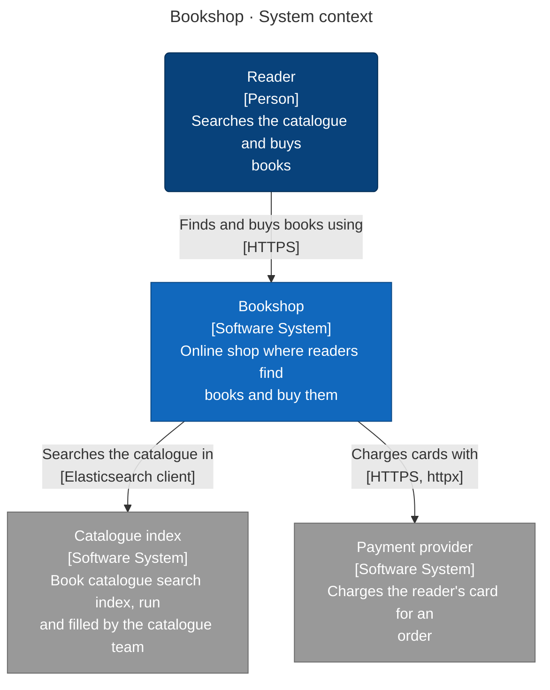

### Level 2: Containers

Mermaid source

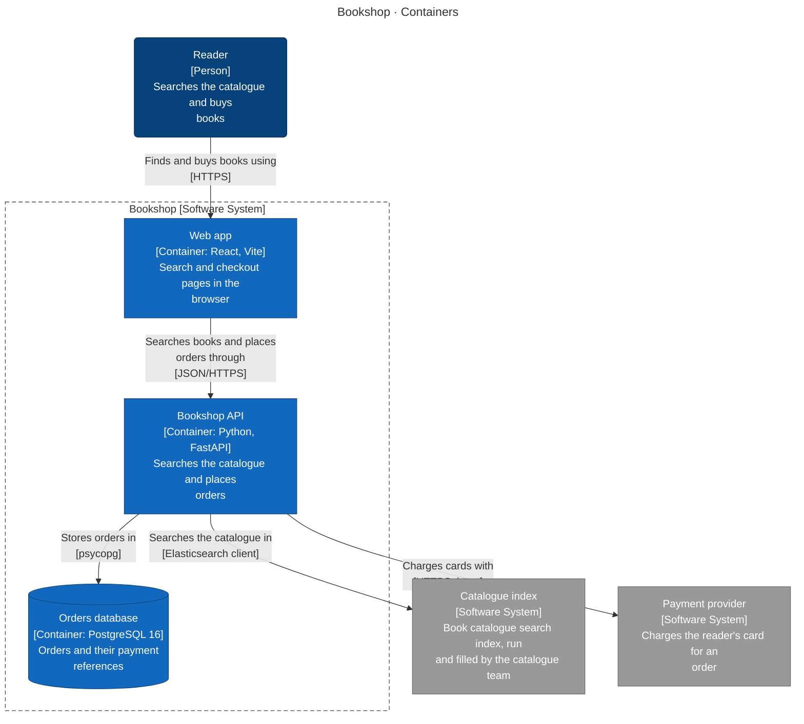

| Container | Technology | Responsibility | Code |
|---|---|---|---|
| **Web app** (container) | React, Vite | Search and checkout pages in the browser | `web` |
| **Bookshop API** (container) | Python, FastAPI | Searches the catalogue and places orders | `api` |
| **Orders database** (data store) | PostgreSQL 16 | Orders and their payment references | — |
| **Catalogue index** (data store) | Elasticsearch | Book catalogue search index, run and filled by the catalogue team | — |

### Level 3: Components

For each container: the modules it is built from (when it has several), then the code structure inside them (packages or namespaces and the imports between them).

#### Bookshop API


Mermaid source

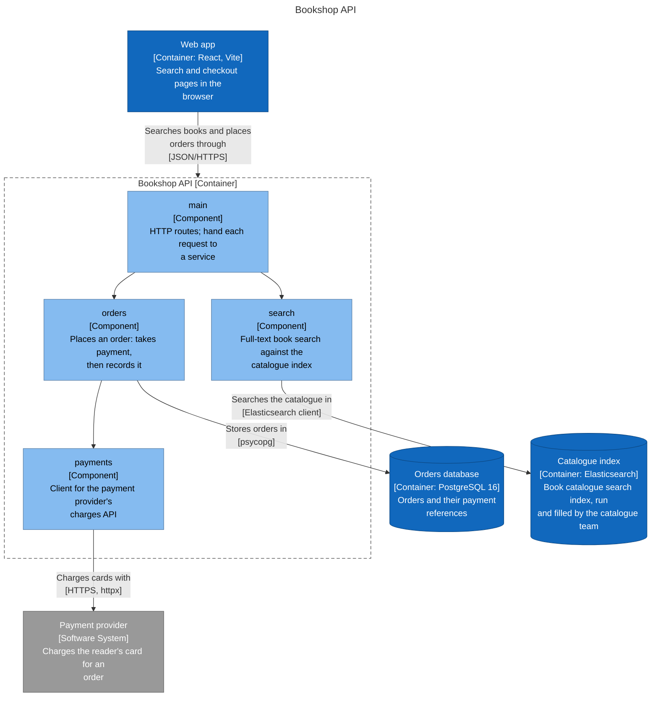

#### Web app


Mermaid source

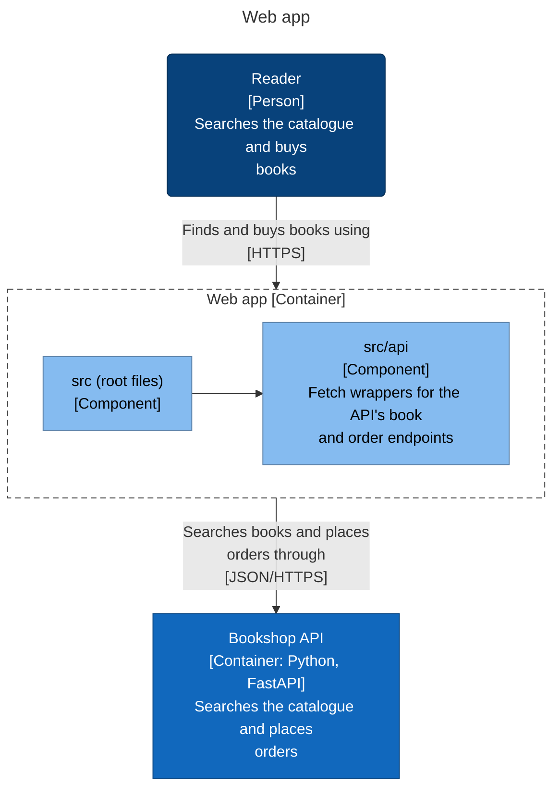

### Level 4: Code

The classes and interfaces of the key components: inheritance, implemented interfaces, dependencies inside the component and public methods. Boxes marked external live in another component.

#### Bookshop API · bookshop.orders

Order placement: payment first, then the order row

> Sources: OrderService → `api/bookshop/orders/service.py:23`, OrderRepository → `api/bookshop/orders/service.py:8`


Mermaid source

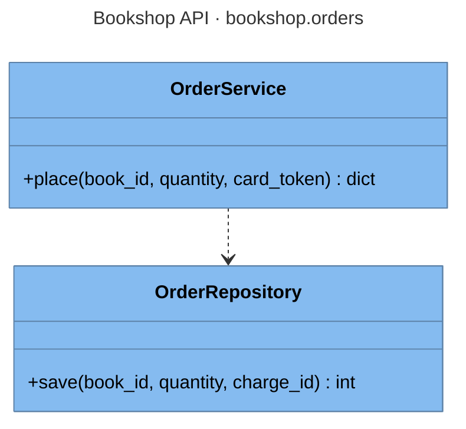

### Key flows

How a request moves through the system, step by step.

#### Reader buys a book

From the Buy button to the stored, paid order.

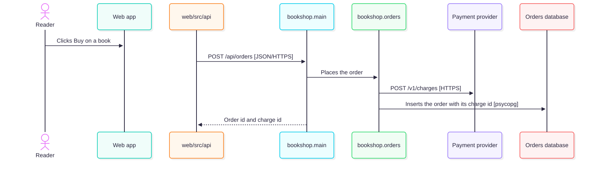

Mermaid source

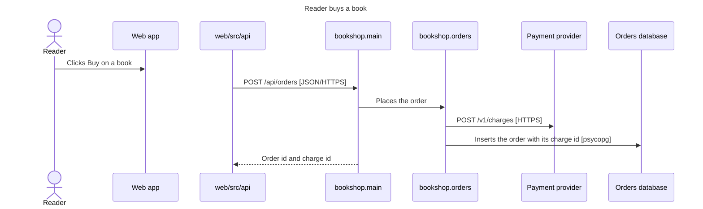

### Deployment

#### docker compose


Mermaid source

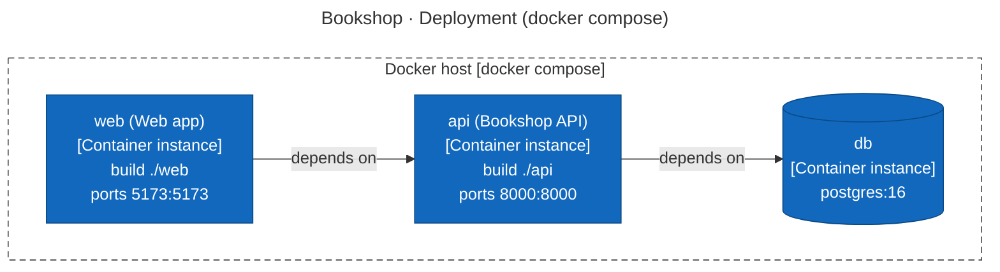

No CI pipeline or hosting configuration was found in the repository.

### API endpoints

2 HTTP route(s) declared in code.

**Bookshop API**

| Method | Path | Declared in |
|---|---|---|
| GET | `/api/books` | `api/bookshop/main.py:11` |
| POST | `/api/orders` | `api/bookshop/main.py:16` |

### Configuration

| Variable | Default | Used by | Declared in |
|---|---|---|---|
| `DATABASE_URL` | `postgresql://bookshop:***@db:5432/bookshop` | Bookshop API | `api/bookshop/orders/service.py:27`, `docker-compose.yml:9` |
| `PAYMENTS_URL` | `https://payments.example/v1` | — | `docker-compose.yml:9` |
| `POSTGRES_DB` | `bookshop` | — | `docker-compose.yml:2` |
| `POSTGRES_PASSWORD` | — | — | `docker-compose.yml:2` |
| `POSTGRES_USER` | `bookshop` | — | `docker-compose.yml:2` |
| `SEARCH_URL` | `https://search.catalog.example` | Bookshop API | `api/bookshop/search/index.py:10`, `docker-compose.yml:9` |

### Technology inventory

Runtime, frameworks and key libraries declared in each container's build files.

| Container | Declared |
|---|---|
| **Bookshop API** | `Python >=3.11`, `fastapi>=0.110`, `uvicorn>=0.29`, `psycopg>=3.1`, `elasticsearch>=8.12`, `httpx>=0.27` |
| **Web app** | `react ^18.3.1`, `react-dom ^18.3.1`, `vite ^5.4.0` |

### Assumptions

Not backed by code evidence; confirm with the team:

- **Reader**: Searches the catalogue and buys books
- **reader → bookshop-web**: Finds and buys books using

### C4 files

- [c4-context.mmd](c4-context.mmd)
- [c4-container.mmd](c4-container.mmd)
- [c4-component-bookshop-api.mmd](c4-component-bookshop-api.mmd)
- [c4-component-bookshop-web.mmd](c4-component-bookshop-web.mmd)
- [c4-flow-place-order.mmd](c4-flow-place-order.mmd)
- [c4-code-bookshop-api-bookshop-orders.mmd](c4-code-bookshop-api-bookshop-orders.mmd)
- [c4-deployment.mmd](c4-deployment.mmd)
- [c4-facts.json](c4-facts.json)
- [c4-model.json](c4-model.json)

[//]: # (c4:end)

---

## Architectural Observations

### Strengths

[//]: # (strengths:start)

- Every container, data store and external system found in the code is in the model.
- Every container says what it is responsible for.
- The model names who the system is for: Reader.
- 1 key flow is written down end to end: Reader buys a book.
- Every container and external system points at the code that proves it.
- No circular project references.

[//]: # (strengths:end)

### Concerns

No automated concerns detected.

---

## Recommendations

No changes recommended from the automated checks. Review the diagram for boundaries the checks cannot see.

---

## Appendix: Project Dependency Graph

Every project or module and every reference between them, tests included. The automated checks above (cycles, stray projects, untested projects) are based on this graph.

**Solutions / build roots:** none found

**Project folders:** api, web

Full dependency graph


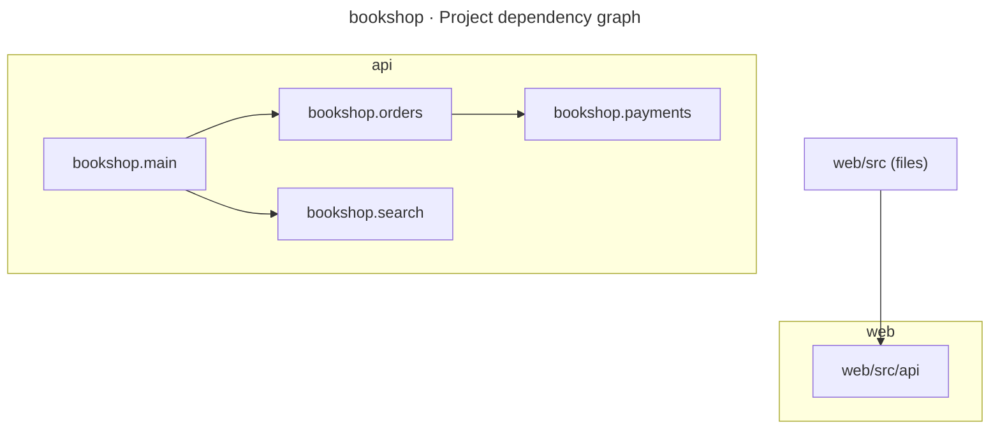

### Components

| Project | Ecosystem | Folder | Kind | Depends on | Used by |
|---|---|---|---|---|---|
| bookshop.main | Python | api | production | 2 | 0 |
| bookshop.orders | Python | api | production | 1 | 1 |
| bookshop.payments | Python | api | production | 0 | 1 |
| bookshop.search | Python | api | production | 0 | 1 |
| web/src (files) | Node.js | - | production | 1 | 0 |
| web/src/api | Node.js | web | production | 0 | 1 |

### Dependency Analysis

### bookshop.main
- depends on bookshop.orders
- depends on bookshop.search

### bookshop.orders
- depends on bookshop.payments
- used by bookshop.main

### bookshop.payments
- no project references
- used by bookshop.orders

### bookshop.search
- no project references
- used by bookshop.main

### web/src (files)
- depends on web/src/api

### web/src/api
- no project references
- used by web/src (files)

---

## Generated Artifacts

- [Diagram image (SVG)](dependency-graph.svg)
- C4 diagrams: listed under Architecture (C4 model) above
- [Mermaid source](dependency-graph.mmd)
- [Dependency data (JSON)](dependency-graph.json)
- [Repository scan (JSON)](repository-scan.json)
- [Summary (JSON)](summary.json)

---

## Report Metadata

Generator Version: 3.5.0

