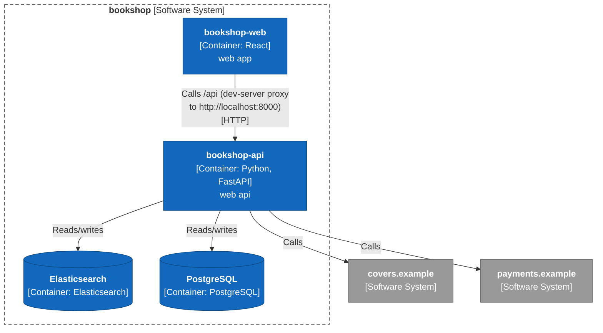
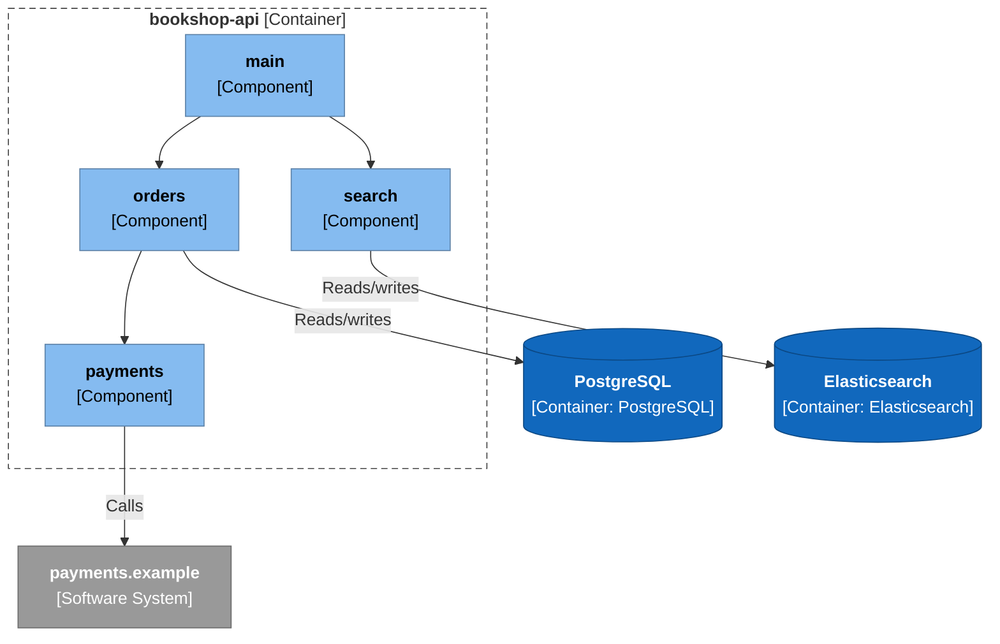
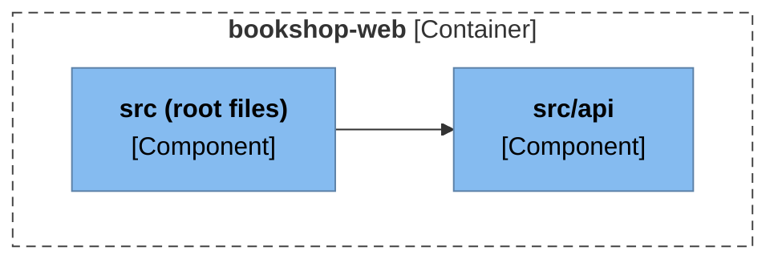
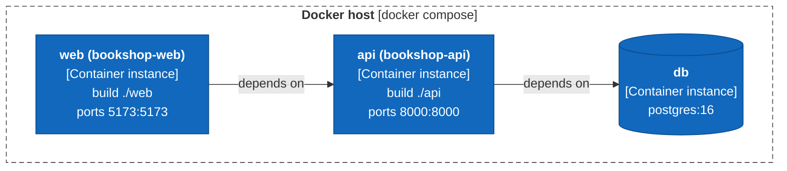
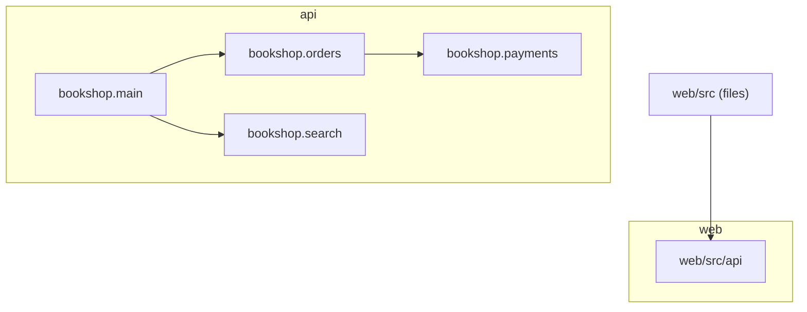

# Architecture Report

## Repository Information

**Repository Name:** bookshop

**Technology Stack:**

- Node.js
- Python
- React

---

## Executive Summary

bookshop has 6 projects (6 production, 0 test) with 4 project references between them. The analysis found no structural concerns.

---

[//]: # (c4:start)

## Architecture (C4 model)

> Drawn from code facts only: no `c4-model.json` yet, so people, external purposes, descriptions and key flows are missing and the System Context level is left out. Write `c4-model.json` and run `render_c4.py` to complete it.

### Level 2: Containers

| Container | Technology | Responsibility | Code |
|---|---|---|---|
| **bookshop-api** (container) | Python, FastAPI | web api | `api` |
| **bookshop-web** (container) | React | web app | `web` |
| **Elasticsearch** (data store) | Elasticsearch | — | — |
| **PostgreSQL** (data store) | PostgreSQL | — | — |

### Level 3: Components

For each container: the modules it is built from (when it has several), then the code structure inside them (packages or namespaces and the imports between them).

#### bookshop-api

#### bookshop-web

### Deployment

#### docker compose

No CI pipeline or hosting configuration was found in the repository.

### API endpoints

2 HTTP route(s) declared in code.

**bookshop-api**

| Method | Path | Declared in |
|---|---|---|
| GET | `/api/books` | `api/bookshop/main.py:11` |
| POST | `/api/orders` | `api/bookshop/main.py:16` |

### Configuration

| Variable | Default | Used by | Declared in |
|---|---|---|---|
| `DATABASE_URL` | `postgresql://bookshop:***@db:5432/bookshop` | bookshop-api | `api/bookshop/orders/service.py:27`, `docker-compose.yml:9` |
| `PAYMENTS_URL` | `https://payments.example/v1` | — | `docker-compose.yml:9` |
| `POSTGRES_DB` | `bookshop` | — | `docker-compose.yml:2` |
| `POSTGRES_PASSWORD` | — | — | `docker-compose.yml:2` |
| `POSTGRES_USER` | `bookshop` | — | `docker-compose.yml:2` |
| `SEARCH_URL` | `https://search.catalog.example` | bookshop-api | `api/bookshop/search/index.py:10`, `docker-compose.yml:9` |

### Technology inventory

Runtime, frameworks and key libraries declared in each container's build files.

| Container | Declared |
|---|---|
| **bookshop-api** | `Python >=3.11`, `fastapi>=0.110`, `uvicorn>=0.29`, `psycopg>=3.1`, `elasticsearch>=8.12`, `httpx>=0.27` |
| **bookshop-web** | `react ^18.3.1`, `react-dom ^18.3.1`, `vite ^5.4.0` |

### C4 files

- [c4-container.mmd](c4-container.mmd)
- [c4-component-bookshop-api.mmd](c4-component-bookshop-api.mmd)
- [c4-component-bookshop-web.mmd](c4-component-bookshop-web.mmd)
- [c4-deployment.mmd](c4-deployment.mmd)
- [c4-facts.json](c4-facts.json)

[//]: # (c4:end)

---

## Architectural Observations

### Strengths

- No circular project references.
- Projects with no project references (the core that the rest builds on): bookshop.payments, bookshop.search, web/src/api.

### Concerns

No automated concerns detected.

---

## Recommendations

No changes recommended from the automated checks. Review the diagram for boundaries the checks cannot see.

---

## Appendix: Project Dependency Graph

Every project or module and every reference between them, tests included. The automated checks above (cycles, stray projects, untested projects) are based on this graph.

**Solutions / build roots:** none found

**Project folders:** api, web

Full dependency graph

### Components

| Project | Ecosystem | Folder | Kind | Depends on | Used by |
|---|---|---|---|---|---|
| bookshop.main | Python | api | production | 2 | 0 |
| bookshop.orders | Python | api | production | 1 | 1 |
| bookshop.payments | Python | api | production | 0 | 1 |
| bookshop.search | Python | api | production | 0 | 1 |
| web/src (files) | Node.js | - | production | 1 | 0 |
| web/src/api | Node.js | web | production | 0 | 1 |

### Dependency Analysis

### bookshop.main
- depends on bookshop.orders
- depends on bookshop.search

### bookshop.orders
- depends on bookshop.payments
- used by bookshop.main

### bookshop.payments
- no project references
- used by bookshop.orders

### bookshop.search
- no project references
- used by bookshop.main

### web/src (files)
- depends on web/src/api

### web/src/api
- no project references
- used by web/src (files)

---

## Generated Artifacts

- C4 diagrams: listed under Architecture (C4 model) above
- [Mermaid source](dependency-graph.mmd)
- [Dependency data (JSON)](dependency-graph.json)
- [Repository scan (JSON)](repository-scan.json)
- [Summary (JSON)](summary.json)

---

## Report Metadata

Generator Version: <version>

