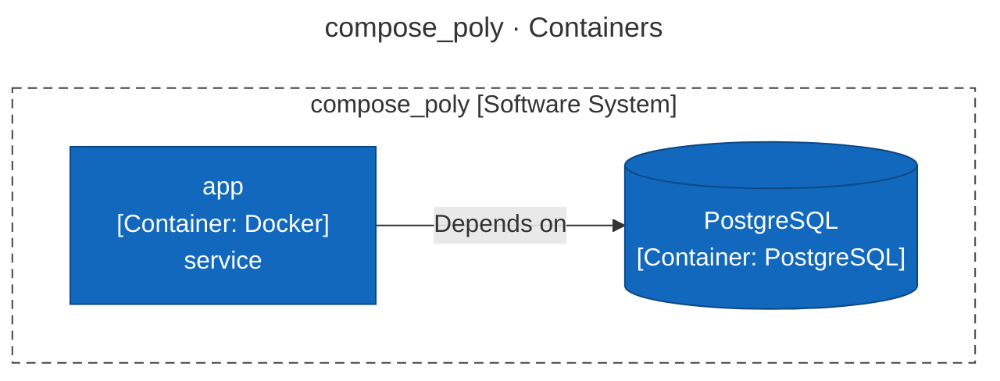
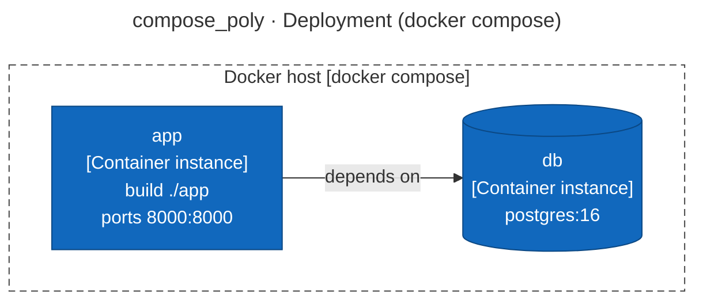
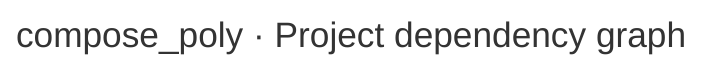

# Architecture Report

## Repository Information

**Repository Name:** compose_poly

**Technology Stack:**

- Unknown

---

## Executive Summary

[//]: # (summary:start)

No supported projects were found in compose_poly (.NET projects, Node.js package.json packages, Python packages, Maven or Gradle modules, Go modules), so this report says nothing about its structure. Analyze it directly.

[//]: # (summary:end)

---

[//]: # (c4:start)

## Architecture (C4 model)

> Drawn from code facts only: no `c4-model.json` yet, so people, external purposes, descriptions and key flows are missing and the System Context level is left out. Write `c4-model.json` and run `render_c4.py` to complete it.

### Diagram key

What the shapes and lines in the diagrams below mean.

| Symbol | Meaning |
|---|---|
| Blue box | **Container** — an application or service that runs on its own. |
| Blue cylinder | **Data store** — a database, cache or queue. |
| Dashed grey outline | The system or the container the diagram is about. |
| Solid arrow | A dependency or a call, labelled with what it does and the technology it uses. |

### Level 2: Containers

| Container | Technology | Responsibility | Code |
|---|---|---|---|
| **app** (container) | Docker | service | `app` |
| **PostgreSQL** (data store) | PostgreSQL | — | — |

### Deployment

#### docker compose

No CI pipeline or hosting configuration was found in the repository.

### Configuration

| Variable | Default | Used by | Declared in |
|---|---|---|---|
| `DATABASE_URL` | `postgresql://acme:***@db:5432/acme` | — | `docker-compose.yml:9` |
| `POSTGRES_DB` | `acme` | — | `docker-compose.yml:2` |
| `POSTGRES_PASSWORD` | — | — | `docker-compose.yml:2` |
| `POSTGRES_USER` | `acme` | — | `docker-compose.yml:2` |

### C4 files

- [c4-container.mmd](c4-container.mmd)
- [c4-deployment.mmd](c4-deployment.mmd)
- [c4-facts.json](c4-facts.json)

[//]: # (c4:end)

---

## Architectural Observations

### Strengths

[//]: # (strengths:start)

No notable strengths detected automatically.

[//]: # (strengths:end)

### Concerns

Not analyzed: no supported projects found.

---

## Recommendations

Not analyzed: no supported projects found.

---

## Appendix: Project Dependency Graph

Every project or module and every reference between them, tests included. The automated checks above (cycles, stray projects, untested projects) are based on this graph.

**Solutions / build roots:** none found

**Project folders:** none

Full dependency graph

### Components

| Project | Ecosystem | Folder | Kind | Depends on | Used by |
|---|---|---|---|---|---|

### Dependency Analysis

---

## Generated Artifacts

- C4 diagrams: listed under Architecture (C4 model) above
- [Mermaid source](dependency-graph.mmd)
- [Dependency data (JSON)](dependency-graph.json)
- [Repository scan (JSON)](repository-scan.json)
- [Summary (JSON)](summary.json)

---

## Report Metadata

Generator Version: <version>

