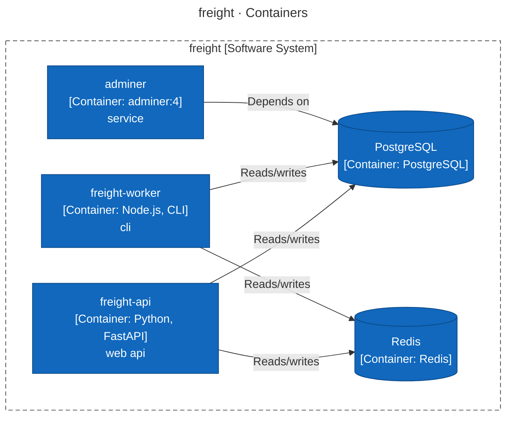
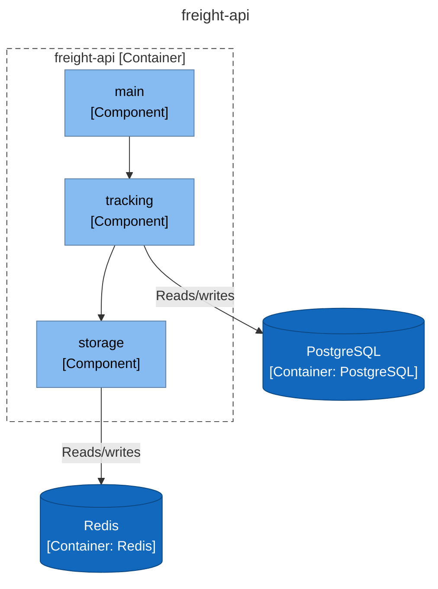
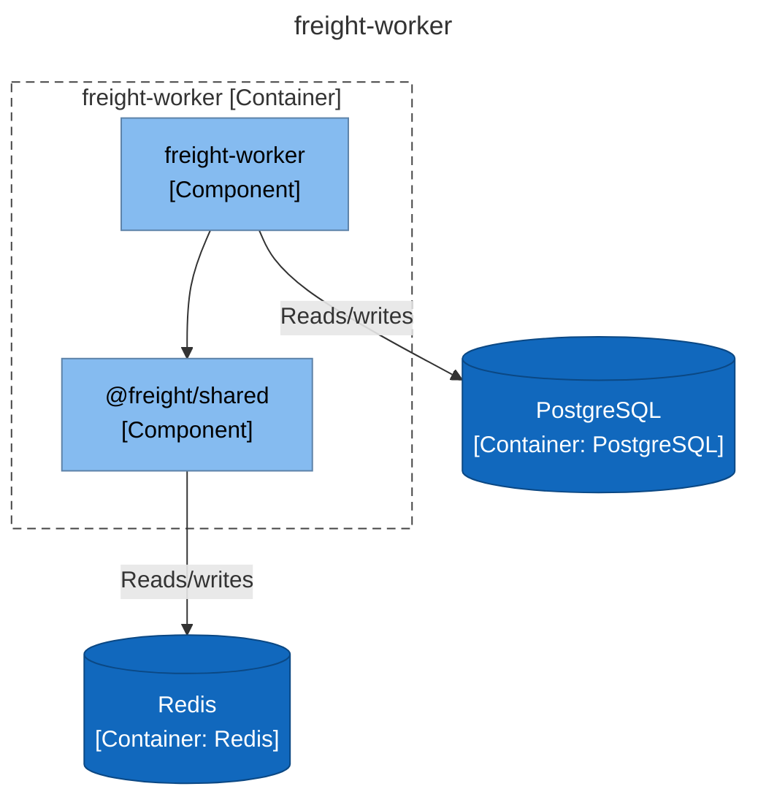
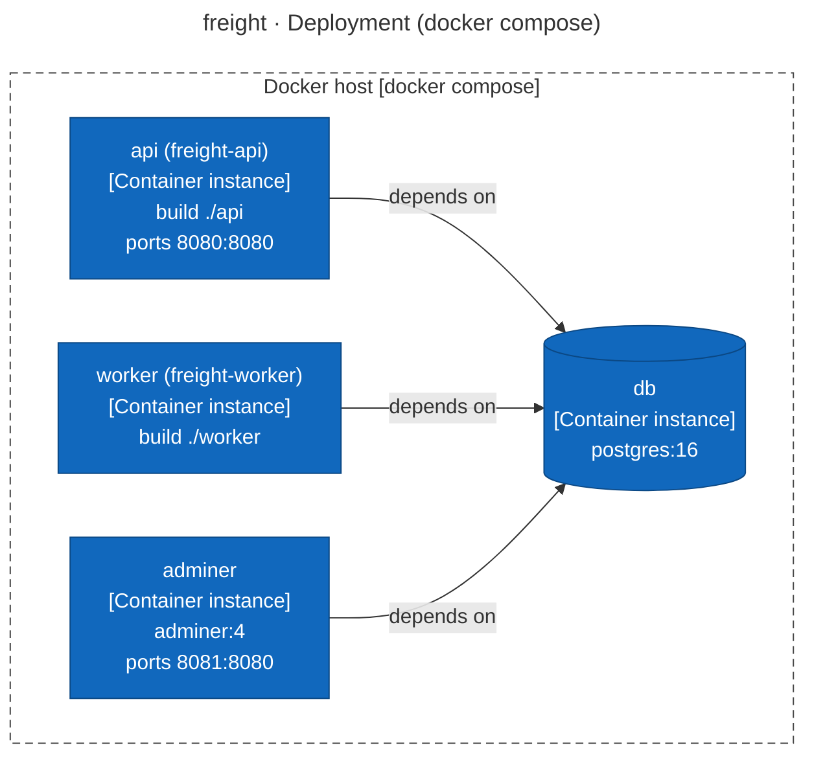
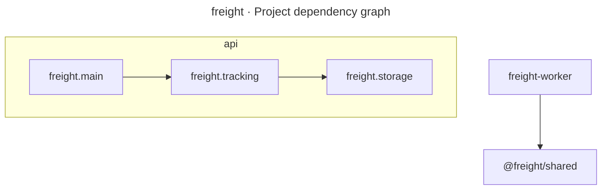

# Architecture Report

## Repository Information

**Repository Name:** freight

**Technology Stack:**

- Node.js
- Python

---

## Executive Summary

[//]: # (summary:start)

freight has 5 projects (5 production, 0 tests) with 3 project references between them.

[//]: # (summary:end)

The automated dependency checks found no structural concerns.

---

[//]: # (c4:start)

## Architecture (C4 model)

> Drawn from code facts only: no `c4-model.json` yet, so people, external purposes, descriptions and key flows are missing and the System Context level is left out. Write `c4-model.json` and run `render_c4.py` to complete it.

### Diagram key

What the shapes and lines in the diagrams below mean.

| Symbol | Meaning |
|---|---|
| Blue box | **Container** — an application or service that runs on its own. |
| Blue cylinder | **Data store** — a database, cache or queue. |
| Light blue box | **Component** — a module, package or namespace inside one container. |
| Dashed grey outline | The system or the container the diagram is about. |
| Solid arrow | A dependency or a call, labelled with what it does and the technology it uses. |

### Level 2: Containers

| Container | Technology | Responsibility | Code |
|---|---|---|---|
| **freight-api** (container) | Python, FastAPI | web api | `api` |
| **freight-worker** (container) | Node.js, CLI | cli | `worker` |
| **adminer** (container) | adminer:4 | service | — |
| **PostgreSQL** (data store) | PostgreSQL | — | — |
| **Redis** (data store) | Redis | — | — |

### Level 3: Components

For each container: the modules it is built from (when it has several), then the code structure inside them (packages or namespaces and the imports between them).

#### freight-api

#### freight-worker

### Deployment

#### docker compose

No CI pipeline or hosting configuration was found in the repository.

### API endpoints

2 HTTP route(s) declared in code.

**freight-api**

| Method | Path | Declared in |
|---|---|---|
| GET | `/api/shipments` | `api/freight/main.py:14` |
| GET | `/api/shipments/{reference}` | `api/freight/main.py:9` |

### Configuration

| Variable | Default | Used by | Declared in |
|---|---|---|---|
| `CACHE_URL` | `redis://cache.freight.example:6379/0` | freight-api, freight-worker | `api/freight/storage/cache.py:14`, `shared/src/cache.ts:8`, `docker-compose.yml:9` |
| `CARRIER_API_URL` | `https://api.carrier.example/v3` | freight-worker | `worker/src/carriers.ts:9`, `docker-compose.yml:19` |
| `DATABASE_URL` | `postgresql://freight:***@db:5432/freight` | freight-api, freight-worker | `api/freight/tracking/service.py:38`, `worker/src/shipments.ts:9`, `docker-compose.yml:9` |
| `POLL_SECONDS` | `60` | freight-worker | `worker/src/poller.ts:6`, `docker-compose.yml:19` |
| `POSTGRES_DB` | `freight` | — | `docker-compose.yml:2` |
| `POSTGRES_PASSWORD` | — | — | `docker-compose.yml:2` |
| `POSTGRES_USER` | `freight` | — | `docker-compose.yml:2` |

### Technology inventory

Runtime, frameworks and key libraries declared in each container's build files.

| Container | Declared |
|---|---|
| **freight-api** | `Python >=3.11`, `fastapi>=0.110`, `uvicorn>=0.29`, `psycopg>=3.1`, `redis>=5.0` |
| **freight-worker** | `redis ^4.7.0`, `typescript ^5.5.4`, `@freight/shared file:../shared`, `pg ^8.12.0` |
| **adminer** | `adminer:4` |

### C4 files

- [c4-container.mmd](c4-container.mmd)
- [c4-component-freight-api.mmd](c4-component-freight-api.mmd)
- [c4-component-freight-worker.mmd](c4-component-freight-worker.mmd)
- [c4-deployment.mmd](c4-deployment.mmd)
- [c4-facts.json](c4-facts.json)

[//]: # (c4:end)

---

## Architectural Observations

### Strengths

[//]: # (strengths:start)

- No circular project references.
- Projects with no project references (the core that the rest builds on): @freight/shared, freight.storage.

[//]: # (strengths:end)

### Concerns

No automated concerns detected.

---

## Recommendations

No changes recommended from the automated checks. Review the diagram for boundaries the checks cannot see.

---

## Appendix: Project Dependency Graph

Every project or module and every reference between them, tests included. The automated checks above (cycles, stray projects, untested projects) are based on this graph.

**Solutions / build roots:** none found

**Project folders:** api

Full dependency graph

### Components

| Project | Ecosystem | Folder | Kind | Depends on | Used by |
|---|---|---|---|---|---|
| @freight/shared | Node.js | - | production | 0 | 1 |
| freight-worker | Node.js | - | production | 1 | 0 |
| freight.main | Python | api | production | 1 | 0 |
| freight.storage | Python | api | production | 0 | 1 |
| freight.tracking | Python | api | production | 1 | 1 |

### Dependency Analysis

### @freight/shared
- no project references
- used by freight-worker

### freight-worker
- depends on @freight/shared

### freight.main
- depends on freight.tracking

### freight.storage
- no project references
- used by freight.tracking

### freight.tracking
- depends on freight.storage
- used by freight.main

---

## Generated Artifacts

- C4 diagrams: listed under Architecture (C4 model) above
- [Mermaid source](dependency-graph.mmd)
- [Dependency data (JSON)](dependency-graph.json)
- [Repository scan (JSON)](repository-scan.json)
- [Summary (JSON)](summary.json)

---

## Report Metadata

- Generated By: architecture-skills plugin, c4-diagrams skill
- Generator Version: <version>
- Source: https://github.com/ythalorossy/architecture-skills

