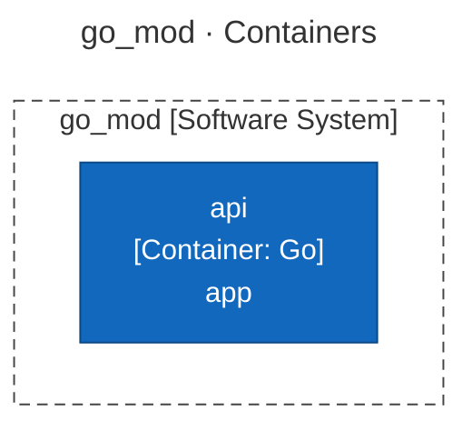
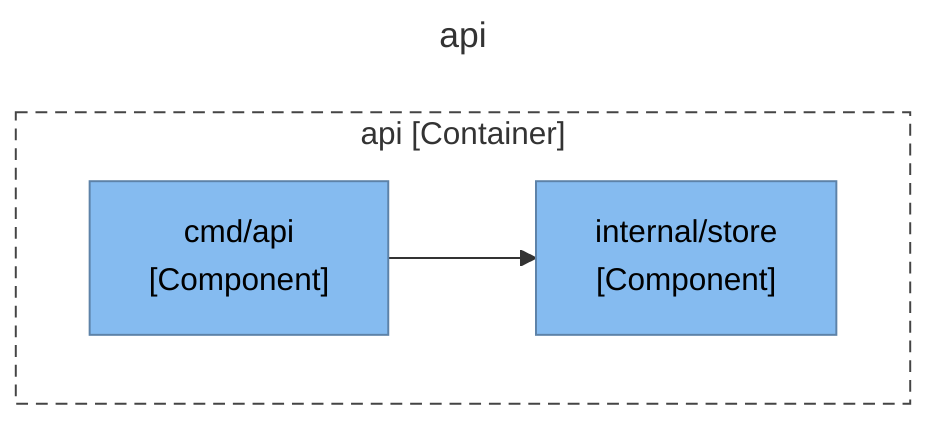
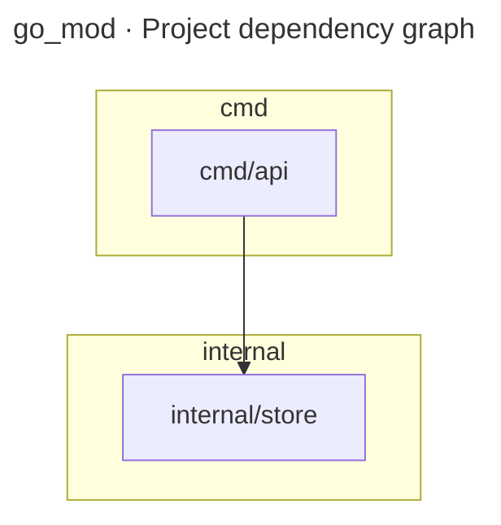

# Architecture Report

## Repository Information

**Repository Name:** go_mod

**Technology Stack:**

- Go

---

## Executive Summary

[//]: # (summary:start)

go_mod has 2 projects (2 production, 0 tests) with 1 project reference between them.

[//]: # (summary:end)

The automated dependency checks found no structural concerns.

---

[//]: # (c4:start)

## Architecture (C4 model)

> Drawn from code facts only: no `c4-model.json` yet, so people, external purposes, descriptions and key flows are missing and the System Context level is left out. Write `c4-model.json` and run `render_c4.py` to complete it.

### Diagram key

What the shapes and lines in the diagrams below mean.

| Symbol | Meaning |
|---|---|
| Blue box | **Container** — an application or service that runs on its own. |
| Light blue box | **Component** — a module, package or namespace inside one container. |
| Dashed grey outline | The system or the container the diagram is about. |
| Solid arrow | A dependency or a call, labelled with what it does and the technology it uses. |

### Level 2: Containers

| Container | Technology | Responsibility | Code |
|---|---|---|---|
| **api** (container) | Go | app | `cmd/api` |

### Level 3: Components

For each container: the modules it is built from (when it has several), then the code structure inside them (packages or namespaces and the imports between them).

#### api

### C4 files

- [c4-container.mmd](c4-container.mmd)
- [c4-component-api.mmd](c4-component-api.mmd)
- [c4-facts.json](c4-facts.json)

[//]: # (c4:end)

---

## Architectural Observations

### Strengths

[//]: # (strengths:start)

- No circular project references.
- Projects with no project references (the core that the rest builds on): internal/store.

[//]: # (strengths:end)

### Concerns

No automated concerns detected.

---

## Recommendations

No changes recommended from the automated checks. Review the diagram for boundaries the checks cannot see.

---

## Appendix: Project Dependency Graph

Every project or module and every reference between them, tests included. The automated checks above (cycles, stray projects, untested projects) are based on this graph.

**Solutions / build roots:** none found

**Project folders:** cmd, internal

Full dependency graph

### Components

| Project | Ecosystem | Folder | Kind | Depends on | Used by |
|---|---|---|---|---|---|
| cmd/api | Go | cmd | production | 1 | 0 |
| internal/store | Go | internal | production | 0 | 1 |

### Dependency Analysis

### cmd/api
- depends on internal/store

### internal/store
- no project references
- used by cmd/api

---

## Generated Artifacts

- C4 diagrams: listed under Architecture (C4 model) above
- [Mermaid source](dependency-graph.mmd)
- [Dependency data (JSON)](dependency-graph.json)
- [Repository scan (JSON)](repository-scan.json)
- [Summary (JSON)](summary.json)

---

## Report Metadata

- Generated By: architecture-skills plugin, c4-diagrams skill
- Generator Version: <version>
- Source: https://github.com/ythalorossy/architecture-skills

