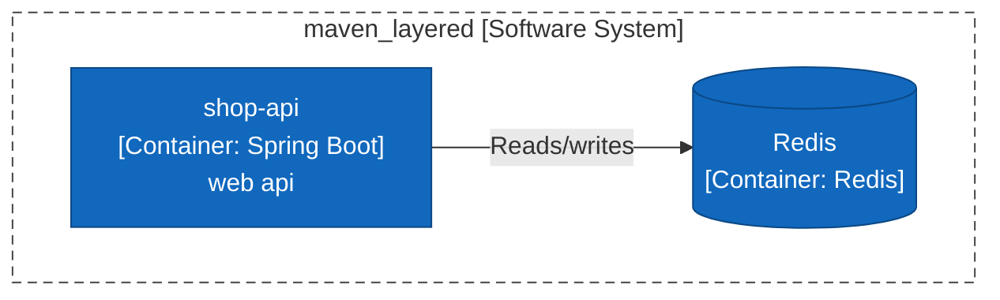
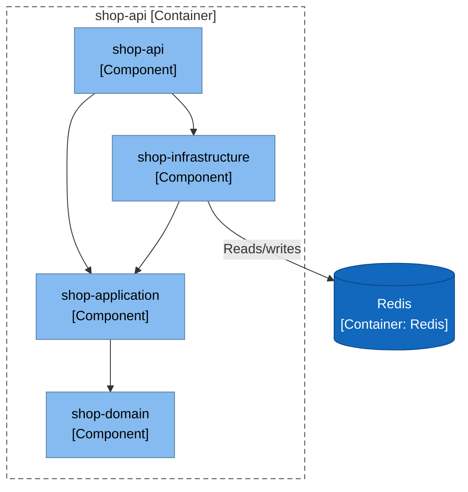
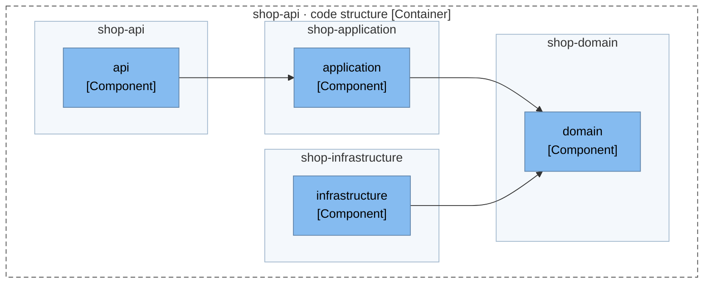
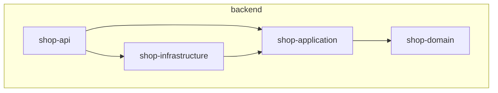

# Architecture Report

## Repository Information

**Repository Name:** maven_layered

**Technology Stack:**

- Java

---

## Executive Summary

maven_layered has 4 projects (4 production, 0 test) with 4 project references between them. The analysis found no structural concerns.

---

[//]: # (c4:start)

## Architecture (C4 model)

> Drawn from code facts only: no `c4-model.json` yet, so people, external purposes, descriptions and key flows are missing and the System Context level is left out. Write `c4-model.json` and run `render_c4.py` to complete it.

### Level 2: Containers

| Container | Technology | Responsibility | Code |
|---|---|---|---|
| **shop-api** (container) | Spring Boot | web api | `backend/shop-api` |
| **Redis** (data store) | Redis | — | — |

### Level 3: Components

For each container: the modules it is built from (when it has several), then the code structure inside them (packages or namespaces and the imports between them).

#### shop-api

#### shop-api · code structure

### API endpoints

1 HTTP route(s) declared in code.

**shop-api**

| Method | Path | Declared in |
|---|---|---|
| POST | `/orders` | `backend/shop-api/src/main/java/com/example/shop/api/OrderController.java:11` |

### Technology inventory

Runtime, frameworks and key libraries declared in each container's build files.

| Container | Declared |
|---|---|
| **shop-api** | `spring-boot-starter-web`, `spring-boot-starter-data-redis` |

### C4 files

- [c4-container.mmd](c4-container.mmd)
- [c4-component-shop-api.mmd](c4-component-shop-api.mmd)
- [c4-structure-shop-api.mmd](c4-structure-shop-api.mmd)
- [c4-facts.json](c4-facts.json)

[//]: # (c4:end)

---

## Architectural Observations

### Strengths

- No circular project references.
- Projects with no project references (the core that the rest builds on): shop-domain.
- Every project is listed in a solution, workspace or aggregator build.

### Concerns

No automated concerns detected.

---

## Recommendations

No changes recommended from the automated checks. Review the diagram for boundaries the checks cannot see.

---

## Appendix: Project Dependency Graph

Every project or module and every reference between them, tests included. The automated checks above (cycles, stray projects, untested projects) are based on this graph.

**Solutions / build roots:** backend/pom.xml

**Project folders:** backend

Full dependency graph

### Components

| Project | Ecosystem | Folder | Kind | Depends on | Used by |
|---|---|---|---|---|---|
| shop-api | Java (Maven) | backend | production | 2 | 0 |
| shop-application | Java (Maven) | backend | production | 1 | 2 |
| shop-domain | Java (Maven) | backend | production | 0 | 1 |
| shop-infrastructure | Java (Maven) | backend | production | 1 | 1 |

### Dependency Analysis

### shop-api
- depends on shop-application
- depends on shop-infrastructure

### shop-application
- depends on shop-domain
- used by shop-api, shop-infrastructure

### shop-domain
- no project references
- used by shop-application

### shop-infrastructure
- depends on shop-application
- used by shop-api

---

## Generated Artifacts

- C4 diagrams: listed under Architecture (C4 model) above
- [Mermaid source](dependency-graph.mmd)
- [Dependency data (JSON)](dependency-graph.json)
- [Repository scan (JSON)](repository-scan.json)
- [Summary (JSON)](summary.json)

---

## Report Metadata

Generator Version: <version>

