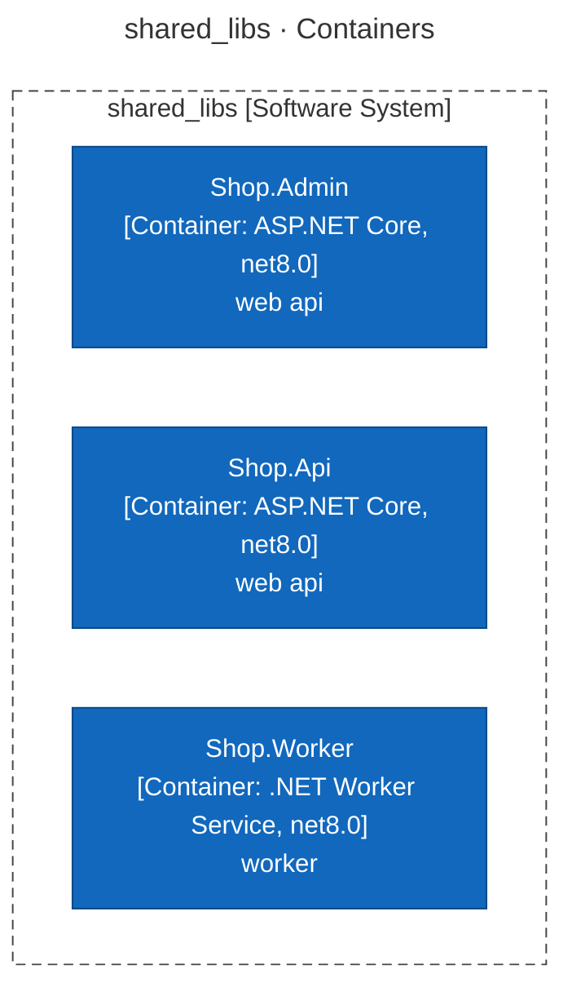
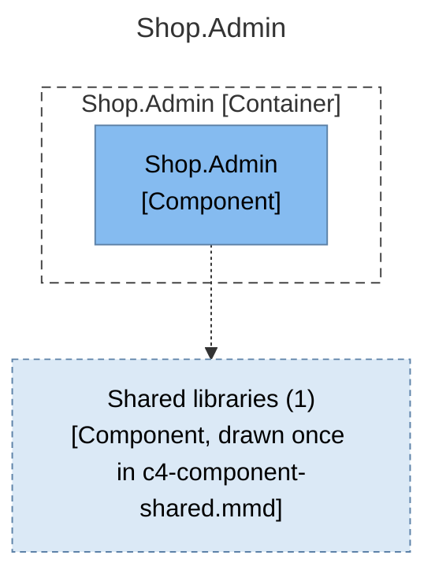
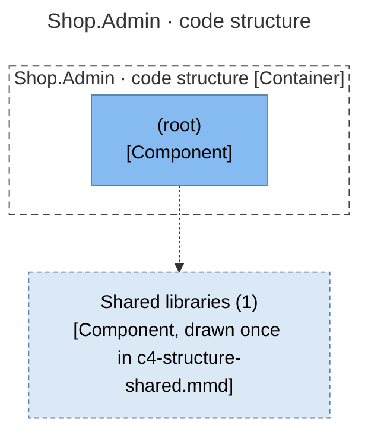
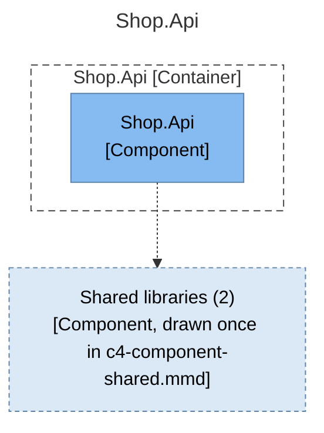
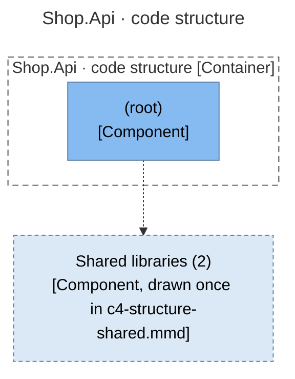
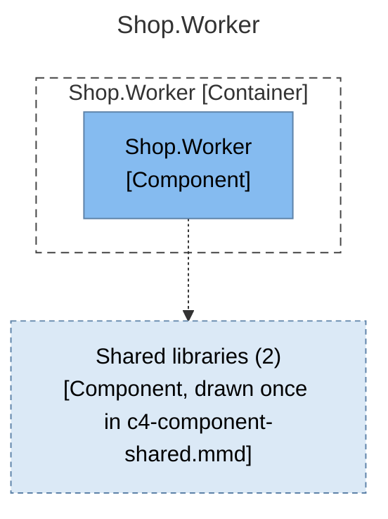
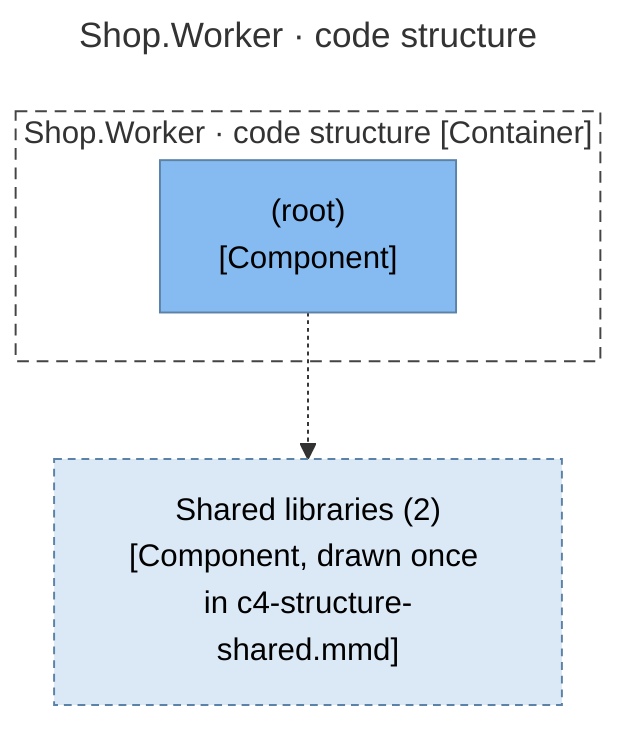
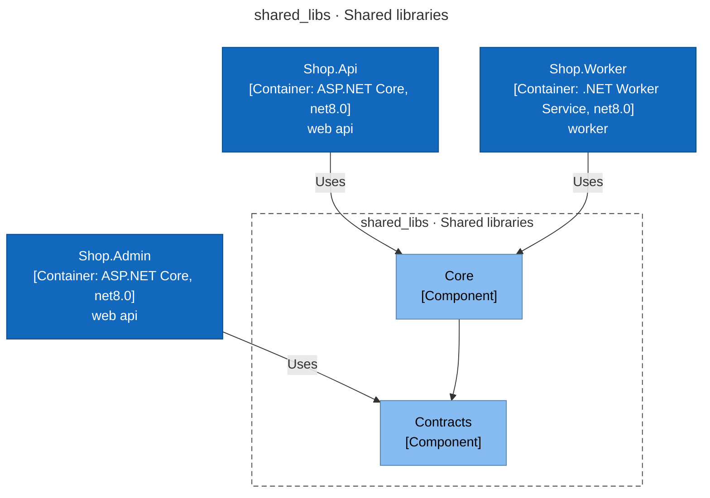
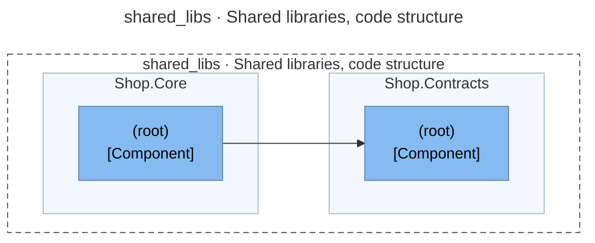
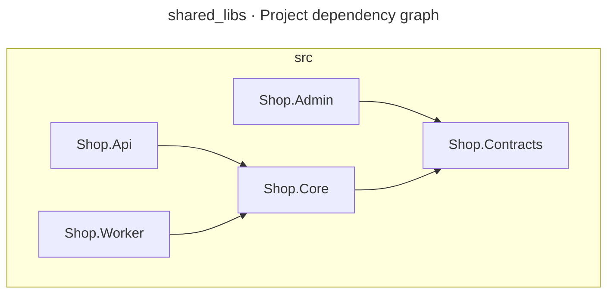

# Architecture Report

## Repository Information

**Repository Name:** shared_libs

**Technology Stack:**

- .NET

---

## Executive Summary

[//]: # (summary:start)

shared_libs has 5 projects (5 production, 0 tests) with 4 project references between them.

[//]: # (summary:end)

The automated dependency checks found no structural concerns.

---

[//]: # (c4:start)

## Architecture (C4 model)

> Drawn from code facts only: no `c4-model.json` yet, so people, external purposes, descriptions and key flows are missing and the System Context level is left out. Write `c4-model.json` and run `render_c4.py` to complete it.

### Diagram key

What the shapes and lines in the diagrams below mean.

| Symbol | Meaning |
|---|---|
| Blue box | **Container** — an application or service that runs on its own. |
| Light blue box | **Component** — a module, package or namespace inside one container. |
| Pale dashed box | Used by most of the other components, drawn in another part of the same view, or shared with another container and drawn once in a shared-libraries view. |
| Dashed grey outline | The system or the container the diagram is about. |
| Solid arrow | A dependency or a call, labelled with what it does and the technology it uses. |
| Dashed arrow | A dependency on a component drawn in another part of the same view. |

### Level 2: Containers

| Container | Technology | Responsibility | Code |
|---|---|---|---|
| **Shop.Admin** (container) | ASP.NET Core, net8.0 | web api | `src/Shop.Admin` |
| **Shop.Api** (container) | ASP.NET Core, net8.0 | web api | `src/Shop.Api` |
| **Shop.Worker** (container) | .NET Worker Service, net8.0 | worker | `src/Shop.Worker` |

### Level 3: Components

For each container: the modules it is built from (when it has several), then the code structure inside them (packages or namespaces and the imports between them).

#### Shop.Admin

> Shop.Contracts is shared with another container and drawn once in c4-component-shared.mmd.

#### Shop.Admin · code structure

> The packages of Shop.Contracts are drawn once in c4-structure-shared.mmd: it is shared with another container.

#### Shop.Api

> 2 components are shared with other containers and drawn once in c4-component-shared.mmd: Shop.Contracts, Shop.Core.

#### Shop.Api · code structure

> The packages of 2 shared libraries are drawn once in c4-structure-shared.mmd: Shop.Contracts, Shop.Core.

#### Shop.Worker

> 2 components are shared with other containers and drawn once in c4-component-shared.mmd: Shop.Contracts, Shop.Core.

#### Shop.Worker · code structure

> The packages of 2 shared libraries are drawn once in c4-structure-shared.mmd: Shop.Contracts, Shop.Core.

#### shared_libs · Shared libraries

> Components used by more than one container, drawn once here instead of in each container's diagram: Shop.Contracts (shop-admin, shop-api, shop-worker); Shop.Core (shop-api, shop-worker).

#### shared_libs · Shared libraries, code structure

> The packages inside the libraries used by more than one container, drawn once here instead of inside every container that uses them.

### API endpoints

2 HTTP route(s) declared in code.

**Shop.Admin**

| Method | Path | Declared in |
|---|---|---|
| GET | `/admin/orders` | `src/Shop.Admin/Program.cs:5` |

**Shop.Api**

| Method | Path | Declared in |
|---|---|---|
| GET | `/orders/{id}` | `src/Shop.Api/Program.cs:6` |

### Technology inventory

Runtime, frameworks and key libraries declared in each container's build files.

| Container | Declared |
|---|---|
| **Shop.Admin** | `net8.0` |
| **Shop.Api** | `net8.0` |
| **Shop.Worker** | `net8.0` |

### C4 files

- [c4-container.mmd](c4-container.mmd)
- [c4-component-shop-admin.mmd](c4-component-shop-admin.mmd)
- [c4-structure-shop-admin.mmd](c4-structure-shop-admin.mmd)
- [c4-component-shop-api.mmd](c4-component-shop-api.mmd)
- [c4-structure-shop-api.mmd](c4-structure-shop-api.mmd)
- [c4-component-shop-worker.mmd](c4-component-shop-worker.mmd)
- [c4-structure-shop-worker.mmd](c4-structure-shop-worker.mmd)
- [c4-component-shared.mmd](c4-component-shared.mmd)
- [c4-structure-shared.mmd](c4-structure-shared.mmd)
- [c4-facts.json](c4-facts.json)

[//]: # (c4:end)

---

## Architectural Observations

### Strengths

[//]: # (strengths:start)

- No circular project references.
- Projects with no project references (the core that the rest builds on): Shop.Contracts.
- Every project is listed in a solution, workspace or aggregator build.

[//]: # (strengths:end)

### Concerns

No automated concerns detected.

---

## Recommendations

No changes recommended from the automated checks. Review the diagram for boundaries the checks cannot see.

---

## Appendix: Project Dependency Graph

Every project or module and every reference between them, tests included. The automated checks above (cycles, stray projects, untested projects) are based on this graph.

**Solutions / build roots:** Shop.sln

**Project folders:** src

Full dependency graph

### Components

| Project | Ecosystem | Folder | Kind | Depends on | Used by |
|---|---|---|---|---|---|
| Shop.Admin | .NET | src | production | 1 | 0 |
| Shop.Api | .NET | src | production | 1 | 0 |
| Shop.Contracts | .NET | src | production | 0 | 2 |
| Shop.Core | .NET | src | production | 1 | 2 |
| Shop.Worker | .NET | src | production | 1 | 0 |

### Dependency Analysis

### Shop.Admin
- depends on Shop.Contracts

### Shop.Api
- depends on Shop.Core

### Shop.Contracts
- no project references
- used by Shop.Admin, Shop.Core

### Shop.Core
- depends on Shop.Contracts
- used by Shop.Api, Shop.Worker

### Shop.Worker
- depends on Shop.Core

---

## Generated Artifacts

- C4 diagrams: listed under Architecture (C4 model) above
- [Mermaid source](dependency-graph.mmd)
- [Dependency data (JSON)](dependency-graph.json)
- [Repository scan (JSON)](repository-scan.json)
- [Summary (JSON)](summary.json)

---

## Report Metadata

- Generated By: architecture-skills plugin, c4-diagrams skill
- Generator Version: <version>
- Source: https://github.com/ythalorossy/architecture-skills

